  

  
  
  

##  About me

<table>
<tr>
<td width="50%" valign="top">

**🇬🇧 EN**

- 🛠 Software Engineer: mobile, desktop and web
- 🎙 Building an **AI agent** that lets you control a computer by voice
- 📈 Making tools to track progress and business metrics
- 🎬 Blogging about AI and development on YouTube

</td>
<td width="50%" valign="top">

**🇷🇺 RU**

- 🛠 Разработчик: мобильные, десктопные и веб-приложения
- 🎙 Делаю **ИИ-агента** для управления компьютером голосом
- 📈 Создаю инструменты для учёта прогресса и метрик
- 🎬 Веду блог про ИИ и разработку на YouTube

</td>
</tr>
</table>

## 🚀 Projects · Проекты

  

## ⚡ Tech Stack · Стек

  

## 📊 GitHub Stats · Статистика

  
  

  

  

  

## 🎬 Latest videos · Новые видео

<!-- BEGIN YOUTUBE-CARDS -->
<!-- END YOUTUBE-CARDS -->

  

## 🤝 Connect · Связь

  
  
  
  
  

